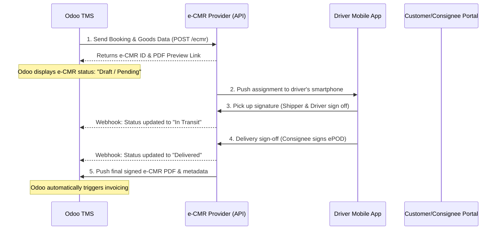

# e-CMR Integration: Strategic Implementation & Analysis Plan

This document outlines the research, feasibility analysis, comparison (Build vs. Buy), and the recommended implementation roadmap for integrating Electronic CMR (e-CMR) into the Transport Management System (TMS) to comply with new European digital freight directives.

---

## 1. Executive Summary: What is e-CMR & Why is it Critical?

### What is e-CMR?
The **CMR Convention** (1956) governs the contract for international road transport of goods in Europe. Historically, this involves a paper **CMR Consignment Note (Waybill)** signed by the Shipper, Carrier (Driver), and Consignee. 
* **e-CMR** is the digitized, legally-binding version under the **2008 Additional Protocol** to the CMR Convention.
* It replaces physical paperwork with electronic records, e-signatures, real-time location/timestamp tracking, and instant digitised proof of delivery (ePOD).

### The Regulatory Trigger: EU Regulation 2020/1056 (eFTI)
* **July 9, 2027 Deadline**: The European Union's **eFTI (Electronic Freight Transport Information)** regulation mandates that all competent authorities (police, customs, transport inspectorates) across EU member states **must accept digital transport data** if provided through a certified eFTI platform.
* Manual paperwork is rapidly becoming obsolete. Integrated e-CMR is now a vital competitive requirement for any European TMS.

---

## 2. Build vs. Buy (Connect) Analysis

When deciding whether to **build a custom e-CMR module from scratch** or **connect to an existing certified provider (e.g., TransFollow, Dashdoc, Leviahub)** via API, we must analyze the following parameters:

| Evaluation Parameter | Option A: Connect to Certified Provider (RECOMMENDED) | Option B: Build Custom from Scratch |
| :--- | :--- | :--- |
| **Development Time** | **Fast** (4 - 6 weeks) | **Extremely Slow** (6 - 12 months) |
| **Upfront Costs** | **Low** (Mainly developer hours to integrate REST APIs) | **Astronomically High** (€80k - €150k+ for dev, legal, and security audits) |
| **Regulatory & Legal Risk** | **Zero**. The provider is legally certified and handles e-signature validity & eFTI standards. | **Very High**. Must comply with eIDAS signature regulations and individual country audit approvals. |
| **eFTI Certification (2027)**| **Handled by Provider**. Major providers are actively certified/complying with EU 2020/1056. | **Requires Custom Certification**. Need independent, state-level audit bodies to certify the custom Odoo platform. |
| **Infrastructure/Mobile Apps**| **Ready-to-Use**. Shippers, carriers, and consignees use the provider's standard web portal and mobile app. | **Must Build Everything**. Need a custom driver app, customer portal, and secure sign-off flows. |
| **Running Costs** | Prepaid credits per e-CMR document (e.g., €0.50 to €1.50 per trip based on volume). | Ongoing server maintenance, API updates, and periodic recertification audits. |

### Recommendation
> [!IMPORTANT]
> **Option A (Connect to an existing provider)** is strongly recommended. Building an e-CMR system from scratch is not just a coding task; it is a complex legal-compliance challenge. Getting custom software legally audited and certified by European transport authorities is extremely expensive and time-consuming. Integrating a market leader like **TransFollow** or **Dashdoc** allows us to focus entirely on Odoo workflows while leaving compliance, cross-border signature validation, and mobile driver interfaces to the provider.

---

## 3. How the API-Based Integration Works

Here is a sequence flow of how Odoo TMS will interact with the e-CMR provider (e.g., TransFollow) during a typical shipment lifecycle:



### Core API Endpoints to Implement (e.g., TransFollow)
1. **`POST /api/v1/consignments`**: Generates a new e-CMR document by sending booking values (Shipper, Carrier, Consignee addresses, Goods packages, LDM, weights, and seal numbers).
2. **`GET /api/v1/consignments/{id}/pdf`**: Fetches the current PDF version of the consignment note.
3. **`POST /api/v1/webhooks`**: Registers webhooks to listen for status changes (e.g., *signed_at_pickup*, *signed_at_delivery*, *cancelled*).
4. **`GET /api/v1/consignments/{id}/signatures`**: Retrieves digital signature files and cryptographic hashes for verification.

---

## 4. Phase-Wise Implementation Roadmap

If the client approves Option A, we can structure the implementation into **4 distinct phases** spanning 6-8 weeks:

```
┌──────────────────────────────────────────────────────────┐
│ PHASE 1: Provider Selection & Sandbox Setup (Weeks 1-2)  │
└────────────────────────────┬─────────────────────────────┘
                             ▼
┌──────────────────────────────────────────────────────────┐
│ PHASE 2: Odoo Backend & API Development (Weeks 3-5)      │
└────────────────────────────┬─────────────────────────────┘
                             ▼
┌──────────────────────────────────────────────────────────┐
│ PHASE 3: Driver Integration & Webhook Setup (Weeks 6-7)   │
└────────────────────────────┬─────────────────────────────┘
                             ▼
┌──────────────────────────────────────────────────────────┐
│ PHASE 4: Pilot Testing & Production Deployment (Week 8)  │
└──────────────────────────────────────────────────────────┘
```

### Phase 1: Provider Selection & Sandbox Setup (Weeks 1-2)
* **Goal**: Register developer sandbox accounts and choose the API partner.
* **Tasks**:
  * Contact **TransFollow** or **Dashdoc** sales to request API sandbox credentials, developer documentation, and bulk credit pricing.
  * Define key fields mapping between Odoo's `transport.order`/`road.assignment` models and the provider's data structures.

### Phase 2: Odoo Backend & API Development (Weeks 3-5)
* **Goal**: Enable Odoo to generate e-CMRs automatically.
* **Tasks**:
  * Create a custom connector module (`transport_management_ecmr`).
  * Add a button on the transport order form: **"Generate e-CMR"** (or automate it upon order confirmation).
  * Build the API client in Python to serialize transport fields and make request calls.
  * Store the returned `ecmr_id` and the PDF link on the Odoo record.

### Phase 3: Driver Integration & Webhook Setup (Weeks 6-7)
* **Goal**: Automate real-time status updates from the field.
* **Tasks**:
  * Create an Odoo controller endpoint to receive Webhook payloads from the provider.
  * When a driver signs off at pickup or delivery, update Odoo's assignment status (e.g., `Draft -> Active -> Closed`) automatically.
  * Download and attach the final legally-certified PDF document to Odoo's Chatter/attachment files.

### Phase 4: Pilot Testing & Production Deployment (Week 8)
* **Goal**: Verify end-to-end flow with real-world scenarios.
* **Tasks**:
  * Test the flow with a test carrier/driver using the provider's mobile app.
  * Verify legal signature validation and data integrity.
  * Train dispatchers on managing exceptions (e.g., rejected shipments, cargo discrepancies recorded on e-CMR).
  * Go live on the production database.

---

## 5. Next Steps & Questions for the Client

To kick off the project, we need the client to clarify:
1. **Preferred Provider**: Do they have an existing relationship with a certified provider like TransFollow, or should we initiate contact and request developer credentials?
2. **Workflow Automation**: Should e-CMR generation be fully automatic when a transport order is set to "Confirmed", or should it be triggered manually by the dispatcher?
3. **Driver Application**: Will their drivers use the standard mobile application provided by the e-CMR partner, or do they require Odoo to pass information directly to a custom driver portal?
